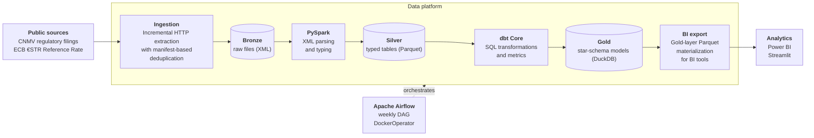
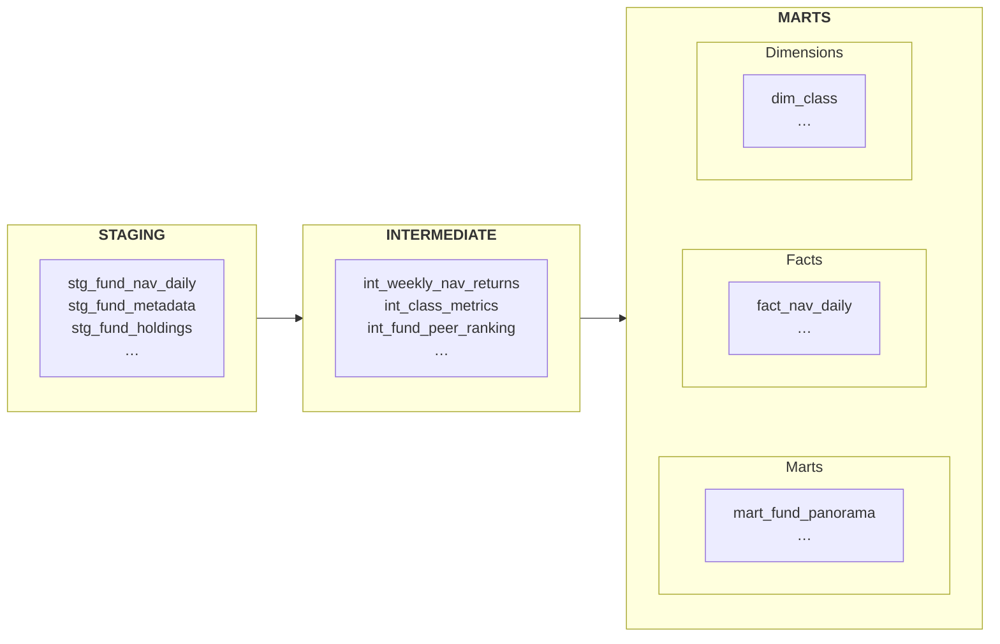
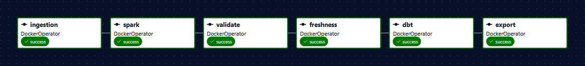
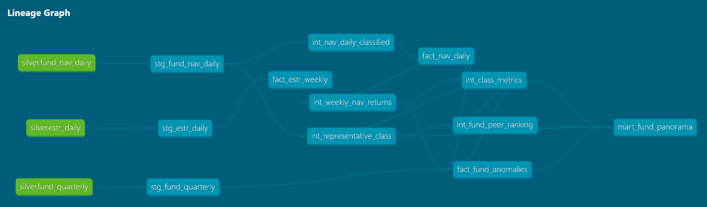

# CNMV Investment Funds Platform

[](https://github.com/a-egealopez/cnmv-investment-funds-platform/actions/workflows/ci.yml)
[](https://github.com/a-egealopez/cnmv-investment-funds-platform/actions/workflows/cd.yml)
[](https://github.com/a-egealopez/cnmv-investment-funds-platform/releases)
[](LICENSE)


**Turning the Spanish securities regulator's public fund filings into a reliable view of the Spanish fund market: performance, risk, flows, fees and portfolios, traceable down to the original file.**

Every month the CNMV publishes raw files covering every investment fund registered in Spain: daily net asset values, assets under management, number of investors, portfolio holdings, fees and income statements. On their own they are hard to use: thousands of funds, several share classes per fund, different reporting frequencies and data errors. This platform cleans, reconciles and models them into a dataset an analyst can trust.

**By the numbers:** €493bn in assets under management · 2,543 fund compartments and 4,739 share classes · 123 management groups · 7.2M daily NAV records · 1.2M portfolio positions · 80 monthly periods (Jan 2020 – Aug 2026) · 270 automated data tests

> Analytical signals built on public data, not investment advice. Metrics are this project's own calculations, not official CNMV figures.

## What it answers

- **Performance vs peers.** How does a fund rank on past risk-adjusted returns (Sortino vs €STR, drawdown, volatility) within its CNMV category?
- **Growth vs flows.** Is a fund growing from returns or from net new money?
- **Market structure.** Which fund groups lead by assets, and which are gaining or losing market share?
- **Fees.** How much of its cost is management and custody fees, and how concentrated is fee revenue across fund groups?
- **Concentration.** How concentrated is its portfolio, and in which asset types? (semiannual)
- **Anomalies.** Which funds show unusual price, flow or fee behaviour, or figures that don't reconcile?
- **Watchlist.** Which 20 funds rank best in their category after strict data-quality screening?

## Key findings (August 2026)

- **Spanish funds nearly doubled since 2020**, from €280bn to €493bn in assets.
- **Half of the growth of the last three years is new money**: of the €152bn added, €79bn came from investors putting in new money and €72bn from market gains (the remaining €1bn comes from mergers and other corporate operations).
- **Five banking groups manage two thirds of the market**: CaixaBank 22.9 %, Santander 14.3 %, BBVA 13.0 %, Kutxabank 8.0 % and Ibercaja 7.4 %. Together they hold 65.5 % of assets, up from 59.3 % in 2020, and collect 60 % of management fee revenue.
- **Kutxabank and Ibercaja grew without takeovers**: both more than doubled their assets since 2020 (+135 % and +118 %), as fast as CaixaBank (+137 %), which absorbed Bankia's €20bn on the way. In the last three years, both took in new money worth about 30 % of what they managed at the start, against 8–19 % for the three largest.
- **The three largest funds are all CaixaBank's**: CaixaBank Monetario Rendimiento (€19.0bn), CaixaBank Master Renta Fija Deuda Pública 3-10 (€9.6bn) and CaixaBank Master Renta Variable USA (€9.5bn).
- **Large funds charge less**: funds above €1bn, 109 out of 1,667, hold 57 % of the money and charge a median 0.62 % a year in management fees. Funds below €50m, half of all funds, charge 1.06 %. So the average euro pays 0.78 %, less than the typical fund's 0.90 %.

Internal analytical figures built from official CNMV data, not official CNMV statistics. Every figure comes from a query in [key_findings.sql](docs/analytics/key_findings.sql).

## Architecture



Each stage runs in its own Docker container and Airflow runs the whole chain every week. More detail in [architecture.md](docs/technical/architecture.md).

## Modern data stack

| Tool | Role | Why |
|---|---|---|
| **Python** | Ingestion | Downloading files is just HTTP, so plain Python is enough |
| **PySpark** | XML parsing | It handles deeply nested XML with explicit schemas, and at this volume it runs fine on a single machine |
| **Parquet** | Storage format | Columnar, typed and compact, and Spark, DuckDB and Power BI all read it |
| **dbt Core** | Transformations | SQL models with tests, documentation and lineage built in |
| **DuckDB** | Analytical database | Fast analytical SQL inside the process, with no server to run |
| **Apache Airflow** | Orchestration | Scheduling and retries, with each stage in its own container so Airflow stays clean |
| **Docker Compose** | Packaging | Every stage runs the same way on a laptop, in CI and under Airflow |
| **GitHub Actions** | CI/CD | Every push is linted, scanned and tested, and images are published to GHCR |
| **Power BI** | Dashboards | It reads the Parquet export directly |

## Data layers

Every CNMV and ECB file lands in **Bronze** exactly as it was published, with a SHA-256 hash so it can always be traced back. PySpark turns those files into six typed Parquet tables in **Silver**, and dbt builds **Gold** on top of them in DuckDB, with a star schema and the analytical marts. The sources are described in [sources.md](docs/analytics/sources.md).



## Data model

A constellation of star schemas: one fact table per business process, each at its own grain, sharing fully denormalized conformed dimensions. Columns, grains and tests for every model are in the [dbt docs](https://a-egealopez.github.io/cnmv-investment-funds-platform/).

```mermaid
flowchart TB
    DD["<b>dim_date</b>"]

    F1["<b>fact_nav_daily</b><br/>(daily, per class)"]
    F2["<b>fact_class_nav_weekly</b><br/>(weekly, per class)"]
    F3["<b>fact_fund_quarterly_metrics</b><br/>(quarterly, per class)"]
    F4["<b>fact_fund_anomalies</b><br/>(one row per flag)"]
    F5["<b>fact_compartment_monthly</b><br/>(monthly, per compartment)"]
    F6["<b>fact_holdings</b><br/>(semiannual, per position)"]
    F7["<b>fact_fund_period_financials</b><br/>(semiannual, per compartment)"]
    F8["<b>fact_manager_group_monthly</b><br/>(monthly, per group)"]
    F9["<b>fact_market_fee_and_aum</b><br/>(monthly, market)"]
    F10["<b>fact_estr_weekly</b><br/>(weekly, risk-free rate)"]

    DC["<b>dim_class</b>"]
    DCO["<b>dim_compartment</b>"]
    DMG["<b>dim_manager_group</b>"]

    DD --- F1 & F2 & F3 & F4 & F5 & F6 & F7 & F8 & F9 & F10

    F1 --- DC
    F2 --- DC
    F3 --- DC
    F4 --- DC
    F4 --- DCO
    F5 --- DCO
    F6 --- DCO
    F7 --- DCO
    F8 --- DMG

    classDef dim fill:none,stroke:#e8a33d,stroke-width:2px
    classDef fact fill:none,stroke:#3b82c4,stroke-width:2px
    class DD,DC,DCO,DMG dim
    class F1,F2,F3,F4,F5,F6,F7,F8,F9,F10 fact
```



## Data engineering practices

### Lineage and reproducibility

- **Traceable to the source.** Every Gold row carries its reporting period and fund keys, which lead to one Silver partition and one Bronze archive, recorded with its source URL, download time and SHA-256 hash.
- **One cut-off date.** A single `meta_run` model defines the reporting date that every dbt model reads, so any past month can be rebuilt exactly as it was.

### Reliable runs

- **Safe to rerun.** Downloads are written atomically, Silver partitions are overwritten rather than appended, and a period is only marked as built once it succeeds.
- **Incremental by default.** Ingestion fetches only new periods and Spark rebuilds only new or changed ones, instead of reprocessing all years.

### Validation

- **Explicit schemas.** Each parser reads the XML with a declared input schema and checks its output against a Silver contract.
- **A quality gate before dbt.** Structural problems in Silver, such as missing periods, duplicate keys or wrong types, stop the pipeline. Semantic issues are reported as warnings instead.
- **Stale data is flagged.** `dbt source freshness` warns when a CNMV or ECB source falls behind its publication cadence (monthly, semiannual or daily), so a late release never goes unnoticed.
- **Nothing is silently dropped.** Suspicious records are quarantined with a reason and surfaced as anomalies, never deleted.

### Testing

- **Checked against official figures.** 270 dbt tests cover keys, value ranges, accounting identities and reconciliation with CNMV figures, and integration tests match the official quarterly returns within a median 0.003 pp.
- **Rules as code.** A dbt test enforces the layer conventions on the model graph, and every threshold in `dbt_project.yml` documents its origin.

## Design trade-offs

Each choice fits today's volume and is designed so that scaling it is a contained change.

| Today | Why it is enough now | How it scales |
|---|---|---|
| PySpark in local mode | About 7M NAV rows fit on one machine | Point the Spark session to a cluster (EMR); the jobs stay the same |
| DuckDB file for Gold | Fast analytics with no server; one pipeline run at a time | The dbt models move to a warehouse adapter (Athena, Redshift) |
| Full Gold rebuild per run | A rebuild takes minutes and keeps every run idempotent | dbt incremental models on the largest facts |
| Airflow through the local Docker socket | Simple and enough on one machine | ECS tasks launched by EcsRunTaskOperator; same DAG, no socket |
| Portfolio data is semiannual | That is how often the CNMV publishes it since 2023 | Nothing to change: it is a property of the source |

## Security and CI/CD

Every push and pull request runs the full CI pipeline in GitHub Actions. When it passes on `master`, a separate CD workflow publishes the images.

| Check | Tool | What it does |
|---|---|---|
| Lint and format | Ruff | Style and common bugs in all Python code |
| Type check | Pyright | Type errors in the pipeline code and unit tests, with the same engine as VS Code |
| SAST | Bandit | Static security analysis of ingestion, Spark and DAG code |
| SCA | pip-audit | Known vulnerabilities in Python dependencies |
| Secret scanning | Gitleaks | Blocks credentials committed by mistake |
| Commit convention | Commitizen | Every commit message follows Conventional Commits |
| Unit tests | pytest + Spark | Parsers, quality gate, incremental runs and atomic downloads |
| Data tests | dbt build | Builds and tests every model on a small fixture dataset |
| Container build | Docker Buildx | Builds the three stage images and the Airflow image, and loads the DAG in it to check its tasks |
| Image scanning | Trivy | Reports critical and high vulnerabilities in every image; base images are patched at build time |
| Continuous delivery | GHCR | Publishes each image tagged with its commit SHA and `latest` |
| Dependency updates | Dependabot | Weekly update PRs for Actions, Python packages and base images |

Workflows run with a read-only token by default, and only the publish job can write packages. Tool versions are pinned so runs are reproducible.

## Results

**Orchestration.** The weekly DAG in Airflow: six containerized tasks from ingestion to the BI export, run in order, with retries and never two runs at once.



**Lineage of the risk metrics.** How a fund's Sortino, volatility and drawdown are built from the CNMV daily prices and the €STR rate, and how they feed the peer ranking, the anomaly flags and the fund panorama, as generated by dbt. Shared dimensions are hidden; the star schema is shown in [Data model](#data-model).



## Documentation

| Area | Document | What's inside |
|---|---|---|
| Business | [product.md](docs/business/product.md) | Problem, users, the questions the platform answers and the risks behind them |
| Analytics | [sources.md](docs/analytics/sources.md) | Every CNMV and ECB dataset: structure, frequency, known issues |
| | [financial_metrics.md](docs/analytics/financial_metrics.md) | Definition, formula and assumptions of every metric, and how they were validated |
| | [key_findings.sql](docs/analytics/key_findings.sql) | The queries behind every figure in Key findings |
| Technical | [architecture.md](docs/technical/architecture.md) | Stack, data layers, pipeline and design decisions |
| | [parsing_decisions.md](docs/technical/parsing_decisions.md) | How each CNMV XML file is turned into a Silver table, and why |
| dbt | [dbt docs](https://a-egealopez.github.io/cnmv-investment-funds-platform/) | Every model and column, tests and the interactive lineage graph (descriptions in Spanish) |
| Notebooks | [exploration/](notebooks/exploration/) | Profiling of the raw sources that set the cleaning rules and thresholds |

## Quickstart

Requires Docker (Docker Desktop on Windows and macOS) and about 4 GB of free disk.

```bash
git clone https://github.com/a-egealopez/cnmv-investment-funds-platform.git
cd cnmv-investment-funds-platform
docker compose build
docker compose up
```

This runs the whole pipeline from January 2020 and leaves the Gold database in `data/gold/cnmv.duckdb` and the Power BI files in `data/exports/gold_bi/`. Later runs only process new periods.

Optional settings go in a `.env` file at the repo root: `SINCE` (first period to download, default `202001`) and `SPARK_DRIVER_MEMORY` (default `3g`).

To run only part of the pipeline:

```bash
# Rerun a single stage, here dbt, without the ones before it
docker compose run --rm --no-deps dbt

# Rebuild Gold as it stood at the end of a past month
docker compose run --rm --no-deps dbt build --vars "{as_of_period: 202512}"

# Skip the local build and use the images published by CD
docker compose -f docker-compose.yml -f docker-compose.ghcr.yml up
```

### Optional: weekly runs with Airflow

```bash
docker compose run --rm airflow-setup
docker compose -f airflow/docker-compose.yml up -d
```

Open http://localhost:8080 (user and password `airflow`), unpause `cnmv_pipeline` and trigger it. The first command only configures `airflow/.env` once. Intended for local use.

## Development

Everything CI checks can also be run locally, without Docker and without downloading any CNMV data. You need Python 3.12 and Java 17 or later (PySpark runs on the JVM).

```bash
python -m venv .venv
source .venv/bin/activate          # Windows: .venv\Scripts\activate
pip install -r requirements.txt
```

**Code.** Ruff checks style and common bugs, and Pyright checks types with the same engine VS Code uses. The unit tests then cover the parsers, the quality gate, incremental runs and atomic downloads, and run against a real local Spark session, so they exercise the same engine as production.

```bash
ruff check . && ruff format --check .
pyright
pytest -q
```

The DAG tests need Airflow, so they are skipped here and run in CI inside the Airflow image.

**Data models.** A small synthetic Silver dataset, generated by a script, is enough to build and test every dbt model. A change to the SQL is therefore checked in under a minute, before it touches the real data.

```bash
python tests/fixtures/build_silver_fixture.py
mkdir data/gold
dbt deps  --project-dir dbt --profiles-dir dbt
dbt build --project-dir dbt --profiles-dir dbt --target ci --exclude assert_panorama_not_empty --vars "{as_of_period: 202605, silver_root: tests/fixtures/silver}"
```

The fixture covers less than three years, so the panorama is empty by design and the test that expects rows in it is skipped.

**Against official figures.** After a full pipeline run, the scripts in `tests/integration/` compare the results with the returns and flows the CNMV publishes, which confirms the calculations on the real data and not only on the fixture.

## Repository structure

```text
├── ingestion/            Download of CNMV archives and ECB €STR
├── spark/
│   ├── parsing/          One parser per source file
│   ├── jobs/             Silver build and quality gate
│   └── common/           Spark session and reporting cadence
├── dbt/
│   ├── models/           staging, intermediate, dimensions, facts, marts, quality, meta
│   ├── macros/
│   ├── seeds/
│   └── tests/            Singular data tests
├── bi/                   Gold export to Parquet
├── dags/                 Airflow DAG
├── airflow/              Airflow image and Compose file
├── docker/               One Dockerfile per stage
├── requirements/         Pinned dependencies per stage
├── tests/
│   ├── unit/             pytest suite
│   ├── integration/      Validation against official CNMV figures
│   └── fixtures/         Small dataset for the CI dbt build
├── notebooks/            Exploration of the raw sources
├── docs/
│   ├── business/
│   ├── analytics/
│   ├── technical/
│   └── images/
└── .github/              CI, CD and Dependabot
```

## Roadmap

- [x] End-to-end pipeline from the CNMV files to Gold
- [x] Orchestration with Airflow
- [x] CI/CD with security scanning and image publishing
- [ ] Power BI dashboard
- [ ] Streamlit app
- [ ] Cloud deployment on AWS

## Disclaimer and license

The data comes from public files published by the CNMV and the European Central Bank. This project is not affiliated with either institution. Every metric is this project's own calculation, and nothing here is investment advice.

The code is released under the [MIT License](LICENSE).
